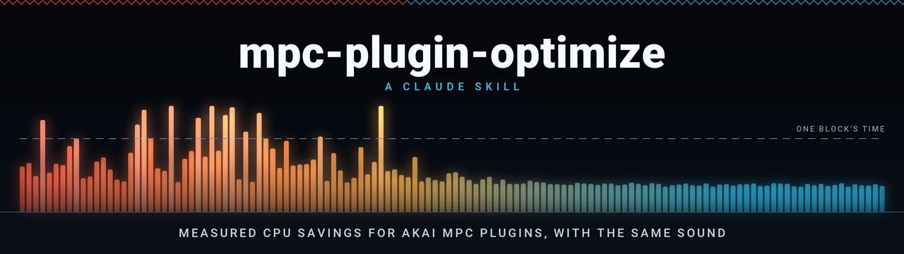
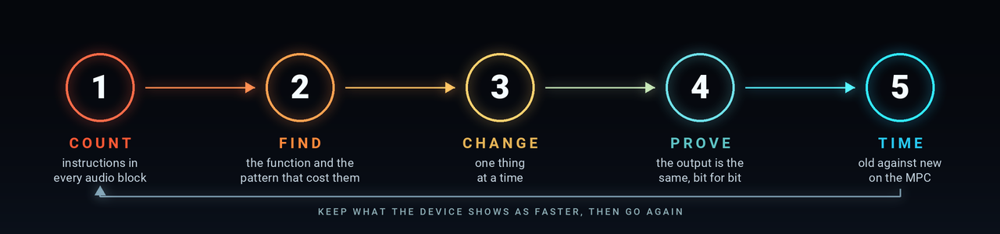

<p align="center">
  
</p>

<p align="center">
  
  
  
  
</p>

<p align="center">
  <b>A Claude skill that makes Akai MPC plugins lighter on the CPU<br>
  and proves the sound stayed the same.</b><br>
  <sub>By anthonytheinventor</sub>
</p>

---

## Why

The 32-bit MPCs (MPC X, Live, Live II, One, One+, Key 61, Key 37 and Force) run plugins on an ARM
Cortex-A17 at 1.6 GHz. Code that feels light on a laptop can cause dropouts there.

This skill gives Claude a measured way to fix that. Claude counts what your code costs, finds the
waste, changes one thing, proves the output, and times the result on a real MPC.

## It knows the chip

The skill carries a field guide to the Cortex-A17, with costs timed on an MPC One+. Claude reads it
before it touches your code, so every choice fits the processor your plugin runs on.

- **What each operation costs.** A float divide takes 18 cycles, a mispredicted branch about 12, and
  a table read that misses the cache up to about 200. Claude estimates each saving from those
  figures before it writes a line.
- **NEON, used where it pays.** Claude runs left and right through one vector instruction where the
  code allows it, and it knows the limits: NEON on this chip has no divide, no square root and no
  rounding.
- **What the compiler leaves behind.** With the SDK's flags the compiler leaves float loops scalar,
  and calls such as `fminf` and `floorf` become library calls. Claude finds both in the assembly.
- **The cache budget.** The data a block touches should fit in about 24 KB of the 32 KB L1 cache.
  Claude weighs a lookup table against plain math with that in mind.
- **Float modes.** Claude knows which float mode the MPC host runs in, and how NEON and scalar code
  treat the tiniest values differently.

## How it works

<p align="center">
  
</p>

<table>
<tr>
<td width="50%" valign="top">

**What Claude does**

- counts the instructions in every audio block of the 32-bit build
- names the functions and the code patterns that cost the most
- reads the whole plugin before choosing, so cheap wins come first
- makes one change at a time
- compares old and new output bit for bit
- times old against new on your MPC

</td>
<td width="50%" valign="top">

**What you decide**

- whether the output may change at all
- whether a change that alters the sound is worth its saving: Claude shows you the time saved and
  the size of the difference in dB, then waits for your answer
- whether Claude may run timing tests on your MPC
- when the plugin is fast enough

</td>
</tr>
</table>

You get a report with the time before and after for every scenario, each change Claude kept, each one
it tried and dropped, and a table of every function it looked at.

## Ask for it

Open your plugin project and ask in plain words:

- "My plugin drops out at 32-frame blocks. Find out why."
- "Cut the CPU of this effect without changing its sound."
- "This plugin fails the CPU bench on the worst block."

Claude loads the skill when the request matches. In Claude Code you can also call it by name:
`/mpc-plugin-optimize:mpc-plugin-optimize` as a plugin, `/mpc-plugin-optimize` as a copied folder.

The skill works with effects and instruments. It starts from plugins built with the MPC Plugin SDK
and also handles ports that bring their own build.

## Install

**Claude Code, as a plugin**

```
/plugin marketplace add anthonytheinventor/mpc-plugin-optimize
/plugin install mpc-plugin-optimize@anthonytheinventor-mpc
```

**Claude Code, by copying**

Copy the folder `skills/mpc-plugin-optimize` into `~/.claude/skills/` to use it in every project, or
into `.claude/skills/` of one project. In a checkout of the MPC Plugin SDK it sits beside the SDK's own
skills.

**Claude apps**

Download `mpc-plugin-optimize.zip` from the latest release and upload it under Settings, Capabilities,
Skills.

## What's inside

Everything lives in `skills/mpc-plugin-optimize/`.

| File | What it does |
|---|---|
| `SKILL.md` | The method: what Claude asks first, the measuring loop, when to stop. |
| `reference.md` | The guide: cycle costs timed on an MPC One+, compiler behavior, the cache budget, NEON rules, how CPU benches behave. Each figure carries a tag that says where it came from. |
| `scripts/count.sh` | Counts the instructions each audio block runs in the 32-bit ARM build, under an emulator, and reports how long the run has left. |
| `scripts/profile.sh` | Shows which functions a costly block spent its instructions in, beside a typical block. |
| `scripts/scan.sh` | Compiles to 32-bit ARM assembly and counts the costly patterns in each function. |
| `scripts/coverage.sh` | Lists every function that ran, with its costs, in a table Claude fills in. You see what it looked at. |
| `scripts/bitcheck.sh` | Proves two versions give the same output bits on 32-bit ARM, or shows where they differ and how large the difference is in dB. It also compares the read-outs and the saved state. |
| `scripts/drive.cpp` | The small host program behind the counts. On an MPC it becomes the timing bench. An events file holds a mode on, places a mode switch, or plays notes into an instrument. |
| `scripts/openmpc-bench.sh` | Fetches the CPU bench of the [Open MPC](https://github.com/open-mpc/mpc-vst-plugins) plugin catalog, builds it and runs it on your MPC, for the verdict that catalog uses. |

The guide also stands alone as reading for anyone who writes DSP for these machines.

<details>
<summary><b>What the scripts need</b></summary>
<br>

- a Linux shell (WSL on Windows) with `zig`, `qemu-arm` 8.1 or later, `nm`, `awk` and `c++filt`
- a checkout of the MPC Plugin SDK
- for the Open MPC bench: `curl`, `ssh` and `scp`, and an MPC with developer mode on

</details>

<details>
<summary><b>Run the scripts yourself</b></summary>
<br>

```
scripts/count.sh <sdk-dir> <plugin.cpp>             # steady state
scripts/count.sh <sdk-dir> <plugin.cpp> 4           # four random parameters per block
scripts/profile.sh <sdk-dir> <plugin.cpp> 4         # which functions the largest block ran
scripts/scan.sh <sdk-dir> <plugin.cpp>              # costly patterns in the assembly
scripts/coverage.sh                                 # the table of everything that ran
scripts/bitcheck.sh <sdk-dir> <old.cpp> <new.cpp>   # same output bits?
scripts/openmpc-bench.sh <plugin-arm32.so> <mpc-ip> # Open MPC's bench, on the device
```

Each script explains its options in the comment at its top.

</details>

<details>
<summary><b>Redraw the pictures</b></summary>
<br>

`python tools/make_readme_art.py` draws the two pictures on this page. It needs Pillow and the Roboto
fonts.

</details>

## License

MIT. See [LICENSE](LICENSE). The pictures use Roboto (Apache 2.0).
